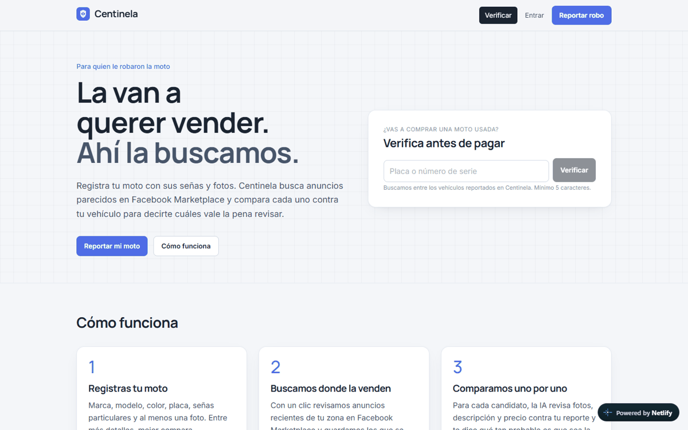
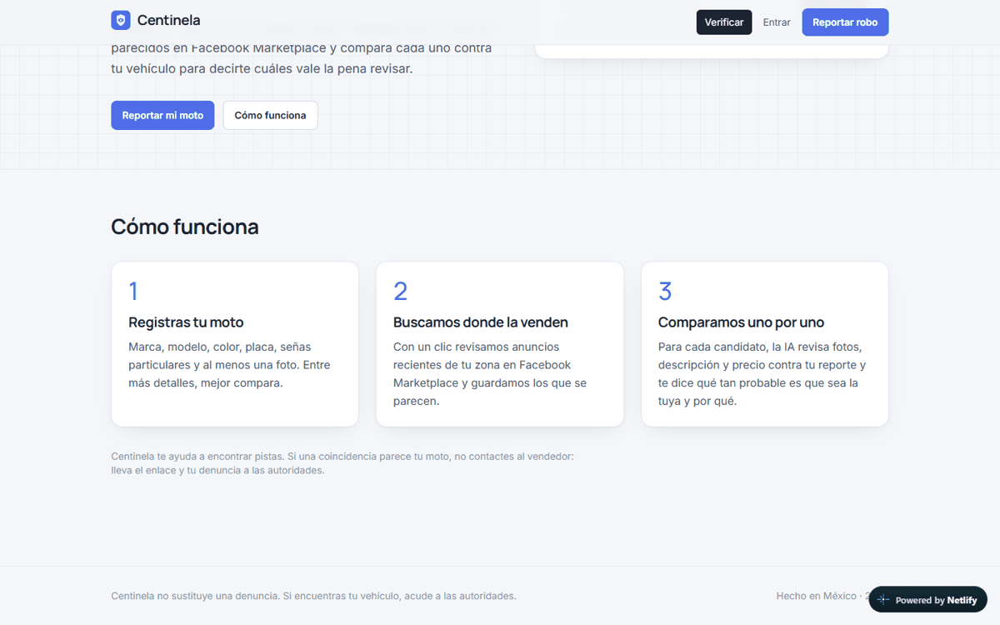
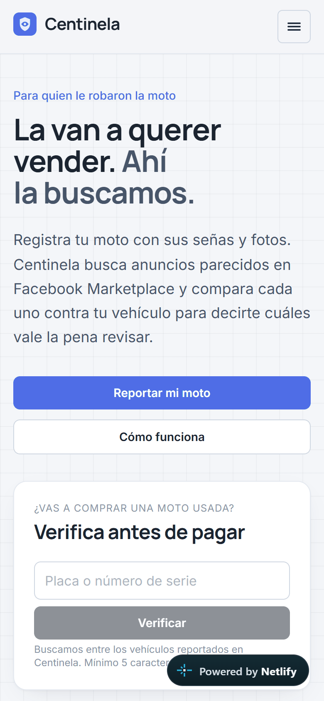

# Centinela — encuentra tu moto robada donde la van a vender

**Demo en vivo:** https://centinela-mx.netlify.app

La víctima registra su vehículo (marca, modelo, señas particulares y fotos). Con un clic, Centinela busca anuncios parecidos en **Facebook Marketplace** y, para cada candidato, **Claude compara fotos y descripción** contra el reporte y dice qué tan probable es que sea esa moto. Cualquier comprador puede verificar una placa o un número de serie antes de pagar.

> 🔒 El código fuente es privado. Este repositorio es una vitrina del proyecto: qué hace, cómo está hecho y pruebas de que funciona.

## Qué hace
- **Reporte del vehículo** en 4 bloques y **ficha** con estado, estadísticas, coincidencias y bitácora de búsquedas.
- **Búsqueda en streaming que gasta lo mínimo:** revisa página por página según un plan, puntúa por título y **se detiene en cuanto encuentra un candidato fuerte**. Solo "investiga" a fondo (lectura completa + IA) lo que pasa el umbral, con máximo 3 análisis por búsqueda.
- **Análisis con visión:** hasta 4 fotos del dueño contra 4 del anuncio, con salida estructurada (probabilidad, coincidencias y diferencias).
- **Verificación pública** de placa o número de serie para compradores.
- Cuentas con roles de usuario y admin, y avisos por correo.

## Stack
React + Vite + TypeScript, Tailwind v4 · Netlify Functions con streaming · Claude (visión y salida estructurada) · Supabase (auth, Postgres con esquema propio, storage) · API de Marketplace de solo lectura · Resend para correo.

## Capturas
| Escritorio | Móvil |
|---|---|
|   |  |
